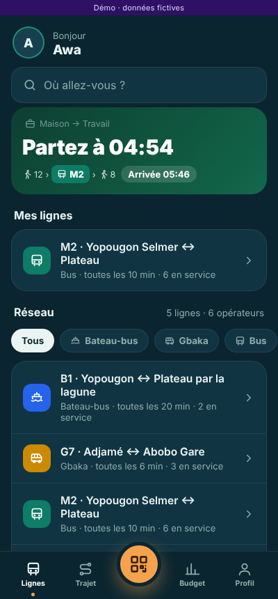
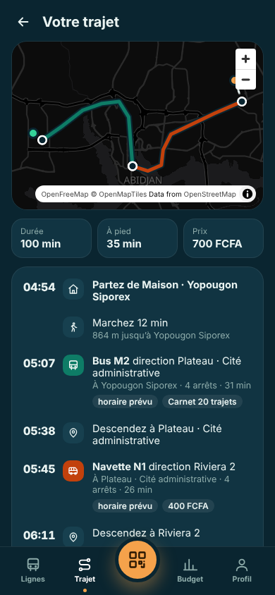
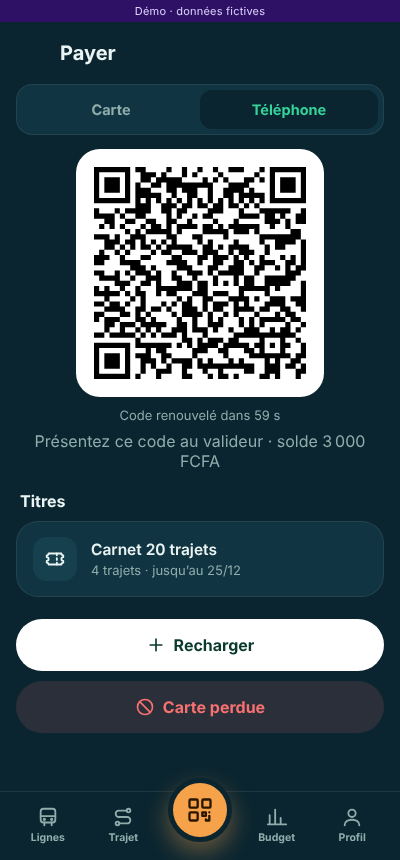
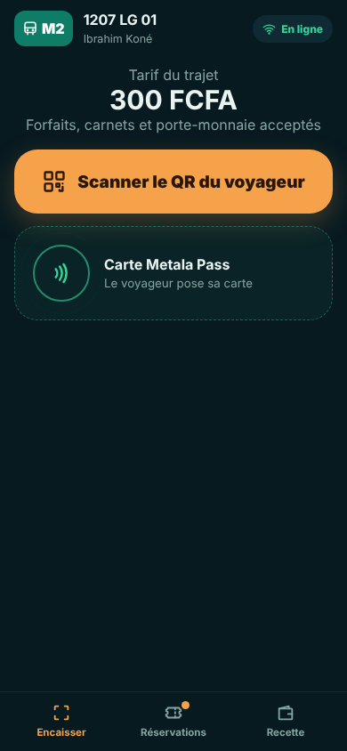
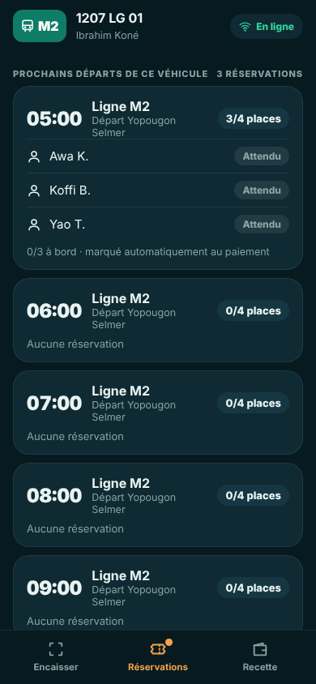
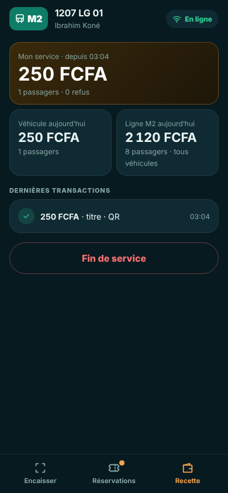
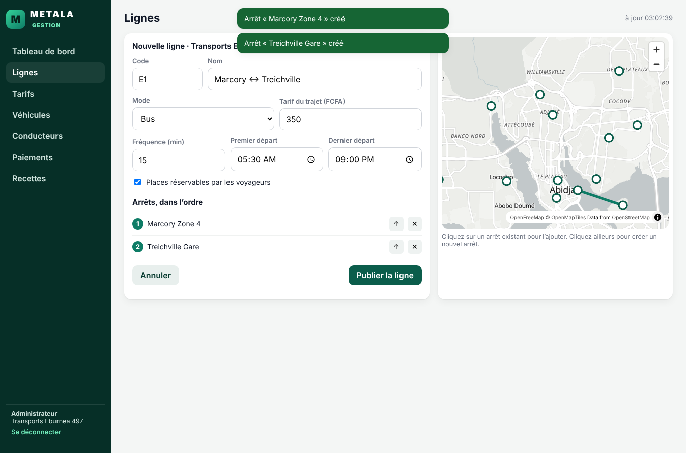

# Metala — prototypes

> **Votre ville. Votre mobilité.**
> Un seul moyen de paiement, le **Metala Pass**, pour voyager avec n'importe quelle compagnie de transport du Grand Abidjan.

Trois applications interactives, construites à partir de la *Proposition stratégique au Conseil* (GENIUS GROUPS SAS) :

| Application | Pour qui | Support | Ce qu'on y fait |
|---|---|---|---|
| **Metala App** `/app/` | Voyageurs | Mobile | Voir les lignes de tous les modes, chercher un trajet **porte-à-porte** depuis chez soi, **réserver** une place, **payer** son trajet ; le **Metala Pass** (carte NFC ou QR du téléphone, porte-monnaie rechargé en Mobile Money) ; suivre son **budget transport** |
| **Metala Scan** `/scan/` | Agents transporteurs (chauffeurs, receveurs) | Mobile | Prendre son service, **encaisser** (QR du voyageur lu par la caméra, carte NFC, montant du compteur pour les taxis), suivre **qui a réservé** et qui est à bord, voir la **recette** du service, du véhicule et de la ligne |
| **Metala Gestion** `/fleet/` | Compagnies (publiques, privées, artisanales, taxis) et Metala | Web | **S'inscrire**, enregistrer **lignes**, **tarifs**, **véhicules** et **conducteurs**, suivre l'**activité des conducteurs** et les paiements, rapprocher les recettes ; le super administrateur Metala supervise toutes les compagnies |

| Lignes | Trajet | Payer | Scan · Encaisser | Scan · Réservations | Scan · Recette |
|---|---|---|---|---|---|
|  |  |  |  |  |  |



> ⚠️ **Prototypes.** Compagnies, lignes, voyageurs et positions GPS sont **fictifs ou simulés** ; aucun paiement réel
> n'est effectué (le prestataire Mobile Money est simulé). Les arrêts reprennent des lieux réels d'Abidjan, à
> coordonnées approximatives.

## Lancer

Prérequis : Go ≥ 1.22. Aucune autre dépendance.

```bash
go run ./cmd/metala
```

Ouvrez <http://localhost:8080>.

### Sur un téléphone

La caméra (lecture du QR dans Metala Scan) exige HTTPS. Sur un ordinateur relié au même Wi-Fi que le téléphone :

```bash
go run ./cmd/metala -https -addr :8443
```

Le serveur affiche ses adresses (`https://192.168.x.x:8443`). Ouvrez-les sur le téléphone et acceptez l'avertissement
du certificat auto-signé. Pour un essai à deux : un téléphone ouvre **Metala App** (Payer → Téléphone), l'autre
**Metala Scan** (Scanner le QR du voyageur).

### Comptes de test

| Application | Identifiant |
|---|---|
| Metala App | bouton « Compte de test · Awa » (code SMS affiché à l'écran) |
| Metala Scan | `01 01 01 01 01` (bus M2) ou `01 01 01 06 01` (taxi compteur), code PIN `1234` |
| Metala Gestion | `fleet@lagune.demo` (compagnie) ou `admin@metala.demo` (super administrateur), mot de passe `metala-demo` — ou « Inscrire ma compagnie » |

Tests : `go test -race ./...`

## Ce que chaque application permet

**Metala App**
- Accueil : « Partez à 07:04 » pour le trajet Maison → Travail, lignes favorites, réseau filtrable par mode (bus, navette, bateau-bus, gbaka, woro-woro, taxi).
- Fiche ligne : tracé, arrêts et heures de passage, fréquence, véhicules en service, réservation.
- Trajet porte-à-porte depuis n'importe quel lieu (maison, travail, repère, position, point sur la carte), « maintenant », « partir à » ou « arriver avant » ; marche, correspondance, horaires et véhicule en direct ; **payer le trajet** en une fois.
- Payer : carte Metala Pass ou **QR à usage unique** renouvelé chaque minute ; recharge Mobile Money ; carnets et forfaits ; blocage de carte perdue.
- Budget : dépenses du mois, projection, 30 derniers jours, répartition par mode, conseils d'économie.

**Metala Scan**
- Connexion de l'agent (numéro, PIN), choix du véhicule de sa compagnie.
- Encaisser : **QR lu par la caméra** (jsQR), carte NFC (cartes de test : un navigateur ne lit pas les cartes DESFire), pavé du compteur pour les taxis ; fonctionnement **hors ligne** avec la carte (porte-monnaie sur la puce) et transmission au retour du réseau.
- Réservations : prochains départs du véhicule, voyageurs ayant réservé, passage automatique « à bord » au paiement.
- Recette : service en cours, véhicule et ligne du jour, dernières transactions, fin de service.

**Metala Gestion**
- Inscription libre des compagnies (catégorie, compte administrateur).
- Lignes : création sur la carte (choix des arrêts, nouvel arrêt d'un clic), fréquence, heures de service, tarif, réservation ; la ligne est aussitôt proposée aux voyageurs et au calcul d'itinéraires.
- Tarifs : tickets, carnets, forfaits ; modification des prix.
- Véhicules (valideur créé automatiquement, blocage à distance) et conducteurs (ajout, statut de service, activité : services, passagers, recette du jour et du mois).
- Paiements (voyageurs anonymes), recettes et rapprochement à 0 écart ; super administrateur : compagnies et cartes.

## Porte-monnaie et paiement hors ligne

Le voyageur **recharge à l'avance** le porte-monnaie de son Metala Pass (1 000, 2 000 ou 5 000 FCFA ; plafond de 20 000 FCFA).

- **En ligne** : le serveur décide. Il utilise d'abord un forfait ou un carnet ; à défaut, il débite le porte-monnaie au tarif du ticket.
- **Hors ligne** : le valideur décide seul. Il authentifie la carte (SAM), consulte la liste noire en cache, puis **débite la puce**. La puce signe la transaction, que le valideur met en file d'attente.
- **Au retour du réseau** : la file est synchronisée. Le serveur vérifie chaque signature, ignore les doublons et paie le transporteur.

On ne peut dépenser que le solde prépayé présent sur la carte : **aucune double dépense**. Une carte perdue se bloque depuis l'App.
Détails dans [`docs/architecture.md`](docs/architecture.md).

## Ce que le prototype respecte du cahier des charges

| Exigence | Mise en œuvre | Test |
|---|---|---|
| Décision de montée toujours prise par le serveur (DEC-05/06) | `platform.Validate` ; le terminal n'affiche que le résultat | — |
| Anti-clonage : jamais l'UID seul | challenge à usage unique de 15 s, puis preuve HMAC avec une clé diversifiée par carte | T-005 |
| Anti double débit | idempotence par `tap_id` + anti-passback de 60 s par véhicule | T-004, T-008 |
| Webhook PSP doublé = 1 titre | signature HMAC, idempotence par `event_id` et par statut, contrôle du montant | T-009 |
| Dernière place : une seule réservation | vérification et incrément atomiques | T-011 |
| GPS de plus de 120 s grisé, sans ETA | fraîcheur : fraîche < 30 s, retardée 30 à 120 s (ETA dégradée), inconnue > 120 s | T-013 |
| Isolation des opérateurs | RBAC + filtrage par `operator_id` à chaque requête Fleet | T-014 |
| Forfait expiré rejeté | contrôle de validité au moment de la montée | T-015 |
| Grand livre = rapports | écritures en partie double, rapprochement à 5 contrôles | T-018 |
| Terminal hors réseau | porte-monnaie débité sur la puce, transaction signée puis synchronisée ; refus explicite pour tout le reste (carte clonée, carte bloquée, solde insuffisant) | `TestOfflineWalletDebitAndSync` |
| Incident | gel de terminal, révocation de carte | test dédié |
| Minimisation des données (loi n° 2013-450) | l'opérateur voit un UID masqué, jamais l'identité du voyageur ; immatriculations non publiques | T-014, API |

Les identifiants T-xxx renvoient aux tests de réception du cahier des charges (§18), repris en Annexe D.

## Architecture

```
cmd/metala/            serveur (API, simulateur GPS, interfaces) ; option -https
internal/platform/     socle : identité, réseau, temps réel, trajets, billettique, porte-monnaie,
                       validation, réservations, conducteurs, gestion, budget, rapprochement
internal/api/          API REST JSON + flux temps réel (SSE)
internal/sim/          simulateur GPS des véhicules et voyageurs fictifs
web/static/            app/ (voyageur), scan/ (agent), fleet/ (gestion) — HTML/JS sans build
docs/                  architecture, API, schéma PostgreSQL/PostGIS cible
```

Détails : [`docs/architecture.md`](docs/architecture.md), [`docs/api.md`](docs/api.md), [`docs/schema.sql`](docs/schema.sql).
État en mémoire (redémarrer le serveur remet les données de test) ; la cible est PostgreSQL + PostGIS.

Carte : OpenFreeMap (données OpenStreetMap), repli automatique sur OpenStreetMap puis CARTO.

## Licences

Code : GENIUS GROUPS SAS. MapLibre GL JS (BSD-3-Clause), qrcode-generator (MIT), jsQR (Apache-2.0) sont
inclus dans `web/static/vendor/`. Fond de carte © OpenFreeMap, OpenMapTiles, contributeurs OpenStreetMap.
