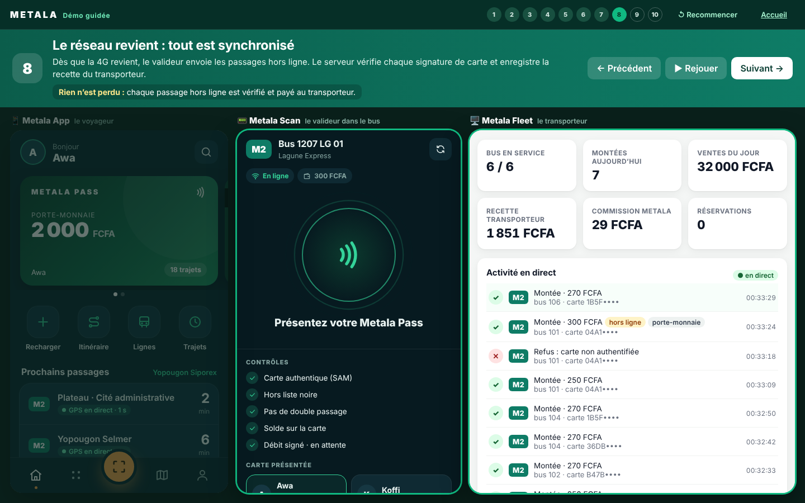
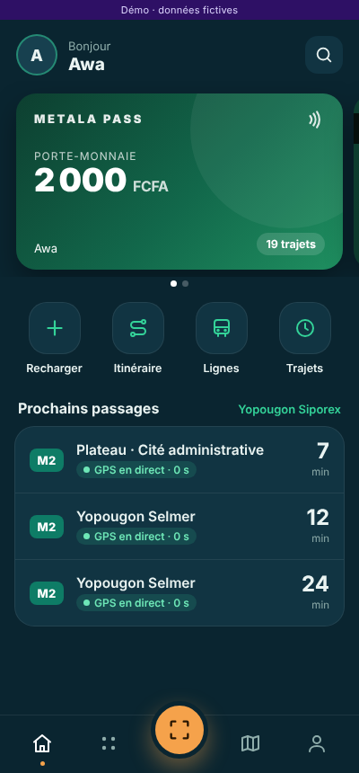
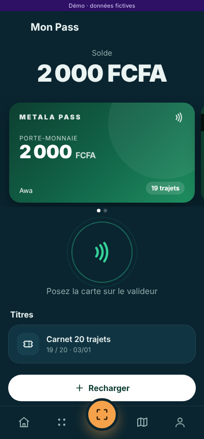
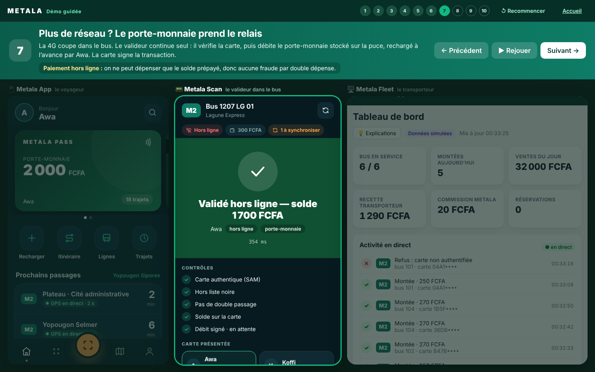

# Metala — prototype MVP

> **Votre ville. Votre mobilité.**
> Une plateforme, plusieurs opérateurs, une expérience de mobilité unifiée pour le Grand Abidjan.

Ce dépôt contient un **prototype fonctionnel** de la plateforme Metala, telle que décrite dans la
*Proposition stratégique au Conseil* (GENIUS GROUPS SAS, 2 novembre 2026) et le cahier des charges MVP v1.0.
Il démontre la boucle complète du MVP : **informer, vendre, valider, rapprocher**, sur le périmètre
du pilote proposé : **2 opérateurs, 10 véhicules, 2 corridors**.

> ⚠️ **Prototype de démonstration.** Opérateurs, lignes, voyageurs, horaires et positions GPS sont
> **fictifs ou simulés**, et toute donnée simulée est étiquetée comme telle dans les interfaces. Aucun
> paiement réel n'est effectué. Ce code ne doit pas servir à une exploitation commerciale : l'exploitation
> payante reste conditionnée aux contrôles techniques, sécuritaires, contractuels et réglementaires (jalon M3).



| Accueil | Mon Pass | Valideur hors ligne |
|---|---|---|
|  |  |  |

## Pour la présentation : la démo guidée

Ouvrez **<http://localhost:8080/demo/>**. La page affiche **l'App, le valideur Scan et le portail Fleet côte à côte**, avec un narrateur
qui raconte le trajet d'Awa en 10 étapes, en 3 à 4 minutes :

1. Awa ouvre Metala : son Pass, son solde, les prochains bus.
2. Elle cherche son trajet vers le Plateau.
3. Elle voit son bus arriver sur la carte, en direct.
4. Elle monte et présente sa carte : « Validé — 18 trajets restants ».
5. Le transporteur voit la montée et la recette instantanément.
6. Une carte copiée est refusée.
7. **Plus de réseau : le porte-monnaie de la carte paie hors ligne.**
8. Le réseau revient : le passage est synchronisé et payé au transporteur.
9. Awa recharge son porte-monnaie en Mobile Money.
10. Chaque franc est rapproché : écart de 0 FCFA.

Commandes : `→` étape suivante, `←` étape précédente, `R` rejouer l'action. **↺ Recommencer** remet les données à zéro.
Sur un écran étroit, des onglets permettent de passer d'un écran à l'autre.

## Les quatre briques

| Brique | Pour qui | Dans le prototype |
|---|---|---|
| **Metala App** | Voyageurs | `/app/` : connexion OTP, carte en direct (MapLibre + OpenStreetMap), recherche de trajet, arrivées estimées avec fraîcheur GPS, alerte à 3 min, achat de titres, réservation, Metala Pass, historique |
| **Metala Pass** | Voyageurs, y compris sans smartphone | Carte NFC simulée : preuve cryptographique dynamique (jamais l'UID seul) et **porte-monnaie** rechargeable, utilisable hors ligne |
| **Metala Scan** | Conducteurs, contrôleurs | `/scan/` : valideur embarqué, décision prise par le serveur, anti double débit, refus explicite hors réseau |
| **Metala Fleet** | Opérateurs de transport | `/fleet/` : tableau de bord, flotte et GPS, gel de terminal, validations, recettes, rapprochement PSP ↔ titres ↔ grand livre, révocation de cartes |

## Démarrage rapide

Prérequis : Go ≥ 1.22. Aucune dépendance externe : bibliothèque standard Go, MapLibre GL embarqué dans le dépôt.

```bash
go run ./cmd/metala
```

Ouvrez ensuite <http://localhost:8080>. Avec Docker :

```bash
docker build -t metala . && docker run --rm -p 8080:8080 metala
```

Les tests :

```bash
go test -race ./...
```

### Parcours de démonstration (5 minutes)

1. **App** (`/app/`) : connectez-vous avec `07 00 00 00 01` (*Awa*, fictive). Aucun SMS n'est envoyé : le code OTP s'affiche à l'écran.
2. Départ *Yopougon Siporex*, destination *Plateau · Cité administrative* : la ligne **M2** s'affiche avec son heure d'arrivée estimée, la fraîcheur du GPS et le badge **Simulé**.
3. **Scan** (`/scan/`) : choisissez un bus M2 et touchez le lecteur avec la carte d'Awa : **« Validé — 18 trajets restants »**.
4. Touchez-le de nouveau : **« Déjà validé — aucun débit »**. Essayez ensuite la *carte clonée* (UID seul), puis cochez *Couper le réseau 4G* : le terminal refuse, il n'affiche jamais de faux succès.
5. **App → Titres** : achetez un carnet en cochant *webhook en double* : **un seul** titre est émis.
6. **Fleet** (`/fleet/`) : `fleet@lagune.demo` / `metala-demo`. Consultez les validations, les recettes et un rapprochement à **0 écart non expliqué**. Gelez un terminal, puis réessayez une validation depuis Scan.
7. **Fleet admin** : `admin@metala.demo` / `metala-demo`. Vue tous opérateurs et révocation d'un Metala Pass.

Comptes de démonstration : `fleet@lagune.demo`, `fleet@ebene.demo`, `admin@metala.demo` (mot de passe `metala-demo`).
Voyageurs fictifs : Awa `07 00 00 00 01` (carnet M2), Koffi `07 00 00 00 02` (forfait N1), Yao `07 00 00 00 03` (sans titre).

## Porte-monnaie et paiement hors ligne

Le voyageur **recharge à l'avance** le porte-monnaie de son Metala Pass (1 000, 2 000 ou 5 000 FCFA ; plafond de 20 000 FCFA).

- **En ligne** : le serveur décide. Il utilise d'abord un forfait ou un carnet ; à défaut, il débite le porte-monnaie au tarif du ticket.
- **Hors ligne** : le valideur décide seul. Il authentifie la carte (SAM), consulte la liste noire en cache, puis **débite la puce**. La puce signe la transaction, que le valideur met en file d'attente.
- **Au retour du réseau** : la file est synchronisée. Le serveur vérifie chaque signature, ignore les doublons et paie le transporteur.

On ne peut dépenser que le solde prépayé présent sur la carte : **aucune double dépense**. Une carte perdue se bloque depuis l'App.
Détails dans [`docs/architecture.md`](docs/architecture.md#porte-monnaie-et-paiement-hors-ligne).

## Ce que le prototype respecte du cahier des charges

| Exigence | Mise en œuvre | Test |
|---|---|---|
| Décision de montée toujours prise par le serveur (DEC-05/06) | `platform.Validate` ; le terminal n'affiche que le résultat | — |
| Anti-clonage : jamais l'UID seul | challenge à usage unique de 15 s, puis preuve HMAC avec une clé diversifiée par carte | T-005 |
| Anti double débit | idempotence par `tap_id` + anti-passback de 60 s par véhicule | T-004, T-008 |
| Webhook PSP doublé = 1 titre | signature HMAC, idempotence par `event_id` et par statut, contrôle du montant | T-009 |
| Dernière place : une seule réservation | vérification et incrément atomiques | T-011 |
| GPS de plus de 120 s grisé, sans ETA | fraîcheur : fraîche < 30 s, retardée 30 à 120 s (ETA dégradée), inconnue > 120 s | T-013 |
| Isolation des opérateurs | RBAC + filtrage par `operator_id` à chaque requête Fleet | T-014 |
| Forfait expiré rejeté | contrôle de validité au moment de la montée | T-015 |
| Grand livre = rapports | écritures en partie double, rapprochement à 5 contrôles | T-018 |
| Terminal hors réseau | porte-monnaie débité sur la puce, transaction signée puis synchronisée ; refus explicite pour tout le reste (carte clonée, carte bloquée, solde insuffisant) | `TestOfflineWalletDebitAndSync` |
| Incident | gel de terminal, révocation de carte | test dédié |
| Minimisation des données (loi n° 2013-450) | l'opérateur voit un UID masqué, jamais l'identité du voyageur ; immatriculations non publiques | T-014, API |

Les identifiants T-xxx renvoient aux tests de réception du cahier des charges (§18), repris en Annexe D.

## Architecture

```
cmd/metala/            point d'entrée (API + simulateurs + interfaces)
internal/platform/     socle commun : monolithe modulaire
  identity.go          OTP, sessions, comptes staff, terminaux, RBAC
  network.go           référentiel réseau, géométrie des tracés
  realtime.go          télémétrie GPS, fraîcheur, ETA
  ticketing.go         produits, paiements PSP, webhooks, titres, grand livre
  validation.go        protocole carte ↔ terminal ↔ serveur, révocation, gel
  reservation.go       départs et réservations
  fleet.go             tableau de bord, journal, rapprochement
  seed.go              données du pilote (fictives) et simulateurs PSP et carte
internal/api/          REST JSON + flux temps réel (SSE)
internal/sim/          simulateur GPS de 10 véhicules et voyageurs fictifs
web/static/            Metala App, Metala Scan, Metala Fleet (HTML/JS sans build)
docs/                  architecture, API, schéma PostgreSQL/PostGIS cible
```

Voir [`docs/architecture.md`](docs/architecture.md) pour le détail et l'écart avec la cible de production,
et [`docs/api.md`](docs/api.md) pour la référence de l'API.

### Écarts assumés avec la cible de production

| Prototype | Cible MVP (proposition, slide 12) |
|---|---|
| État en mémoire, verrou unique | PostgreSQL + PostGIS + Redis, transactions ACID ([`docs/schema.sql`](docs/schema.sql)) |
| Interfaces web | Metala App en Flutter (Android et iOS), Metala Scan en Flutter Android NFC |
| Server-Sent Events | WebSocket via la passerelle API |
| Carte et porte-monnaie virtuels (HMAC) | MIFARE DESFire EV3 ou équivalent, authentification AES, SAM ; choix à confirmer en POC (M1). Le standard Calypso du PMDIA reste à étudier. |
| PSP simulé | GeniusPay vers des PSP habilités ; avis juridique, Instruction BCEAO n° 001-01-2024 |
| OTP affiché à l'écran | Passerelle SMS ; limitation de débit |
| Secrets de démonstration | Gestion des secrets, rotation, environnements séparés |

## Configuration

| Variable | Rôle |
|---|---|
| `METALA_ADDR` | adresse d'écoute (défaut `:8080`) |
| `METALA_ENV=production` | désactive les simulateurs (`/api/dev/*`, OTP affiché) et exige les deux secrets ci-dessous |
| `METALA_CARD_MASTER_KEY` | clé maître de diversification des cartes (≥ 32 caractères) |
| `METALA_PSP_WEBHOOK_SECRET` | secret de signature des webhooks PSP (≥ 32 caractères) |

Options : `-sim=false` désactive le simulateur GPS, `-riders=false` désactive les montées simulées, et
`-web-dir web/static` sert les interfaces depuis le disque (pratique pour modifier le HTML/CSS/JS sans recompiler).

## Fond de carte

La carte utilise **OpenFreeMap** (tuiles vectorielles, gratuites, sans clé, données OpenStreetMap), avec les styles *positron*
(Fleet) et *dark* (App). Si le service ne répond pas, la carte bascule automatiquement sur les tuiles OpenStreetMap puis CARTO.
Lignes, arrêts et bus restent affichés même sans fond. Le serveur envoie l'en-tête `Referrer-Policy: strict-origin-when-cross-origin`,
exigé par OpenStreetMap.

## Feuille de route après le prototype

Ce prototype s'inscrit dans la feuille de route de 14 semaines :

- **S1–S2 (M1)** : POC NFC sur 2 téléphones Android et 2 fournisseurs de cartes ; remplacer la carte virtuelle par la vraie authentification DESFire.
- **S3–S4** : migrer le socle vers PostgreSQL/PostGIS (`docs/schema.sql`), mettre en place CI/CD et observabilité.
- **S5–S7** : relevés terrain des arrêts et tracés, application Driver GPS, ETA calibrée sur les données réelles.
- **S7–S10 (M2)** : intégration GeniusPay et PSP habilité, premier paiement réconcilié.
- **S10–S14 (M3)** : audit de sécurité, terrain avec 10 véhicules, décision Go/No-Go.

## Licence et données

Code : propriété de GENIUS GROUPS SAS, tous droits réservés, sauf mention contraire. MapLibre GL JS est distribué sous licence BSD-3-Clause
(`web/static/vendor/maplibre-gl-4.7.1/LICENSE.txt`). Fond de carte © contributeurs OpenStreetMap ; pour un
usage au-delà de la démonstration, utiliser un fournisseur de tuiles ou un serveur de tuiles propre.
